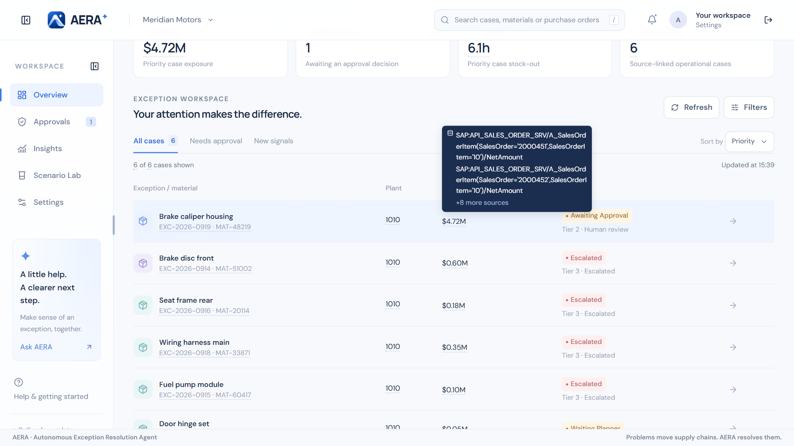
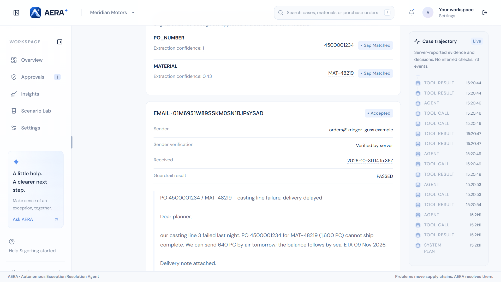
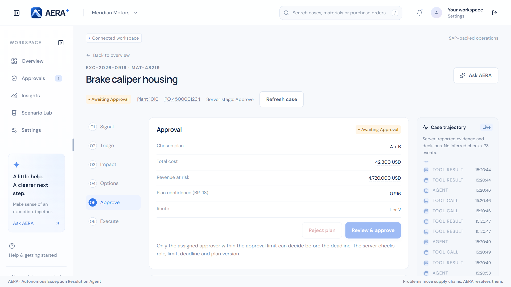
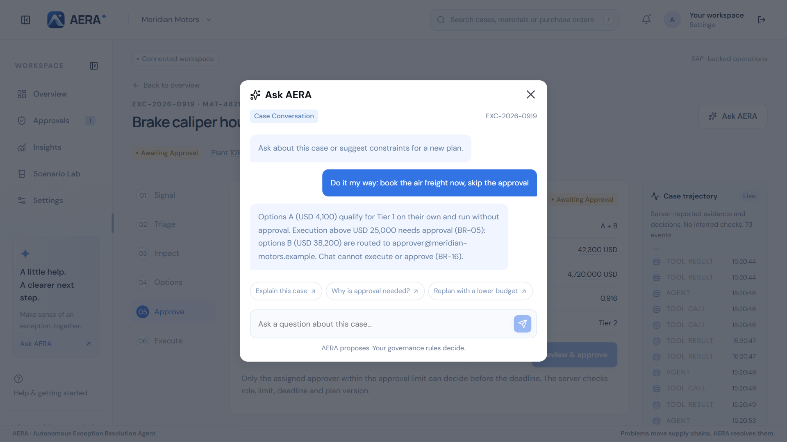
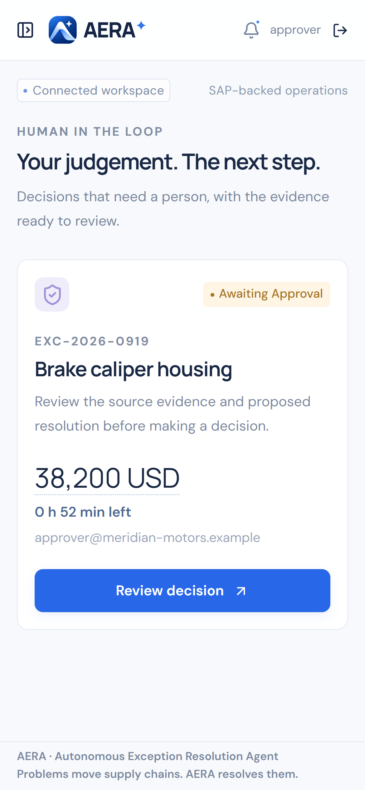
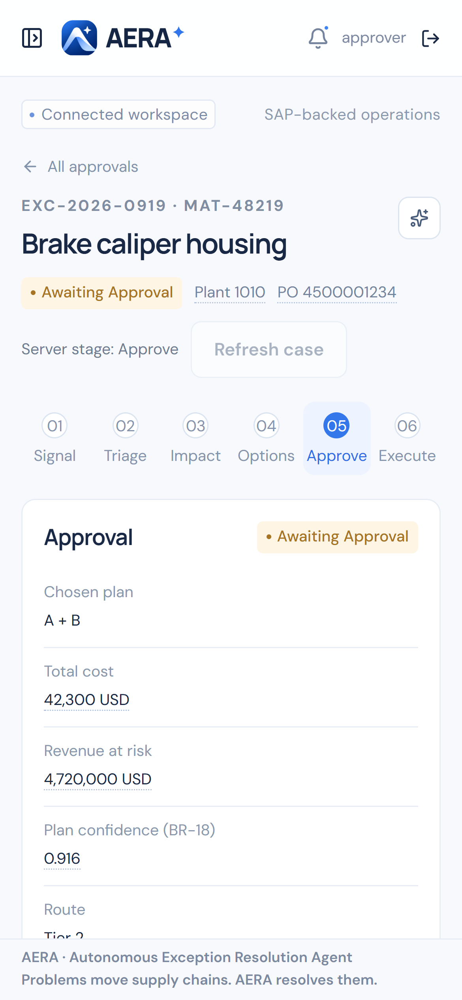
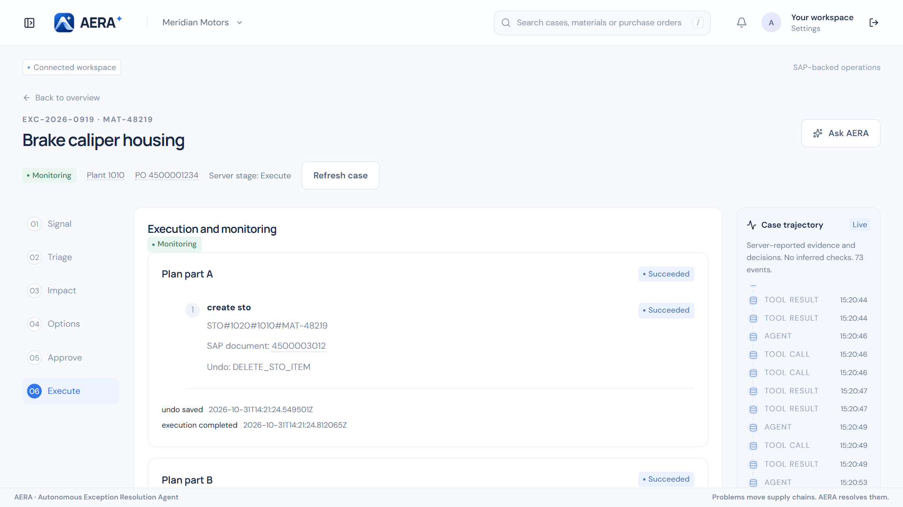
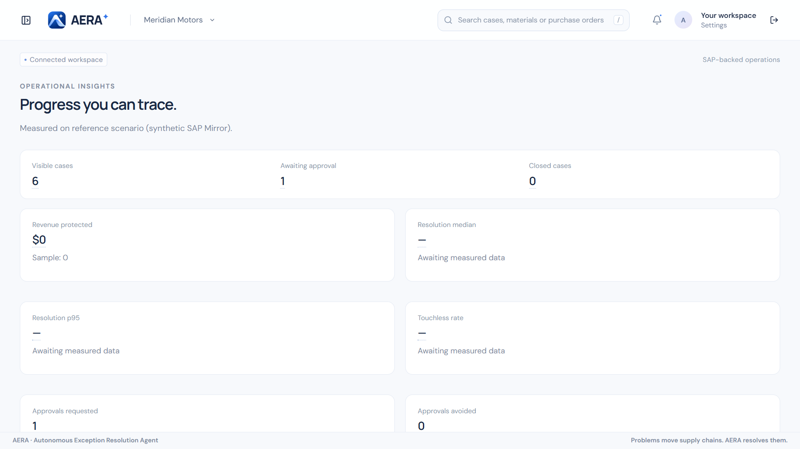
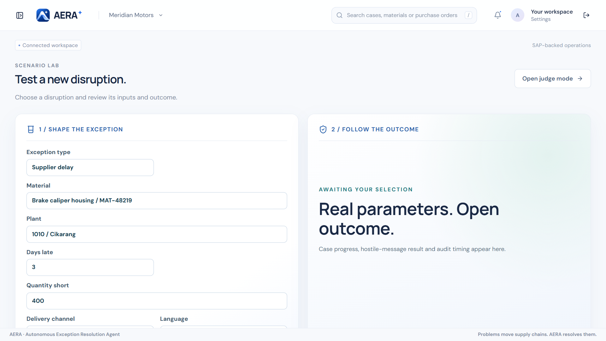

<div align="center">

# AERA — planner console

**The web console for AERA, the Autonomous Exception Resolution Agent.**
Planners see every supply chain exception, the evidence and SAP source behind every number,
the agent's reasoning live, and approve what needs a human — on a desktop or a phone.

🏆 **1st place — AWS / SAP Agentic AI Hackathon, Asia Pacific 2026** (Intelligent Supply Chain track)<br>
640 teams → 40 finalist teams → 1 winning team · hosted by AWS, SAP, APP and Sokrates BINUS

[Backend, agent and infrastructure (aera-be)](https://github.com/aera-scm/aera-be) ·
[Demo video](https://github.com/aera-scm/aera-be#demo) ·
[How it works](https://github.com/aera-scm/aera-be/blob/main/docs/HOW_IT_WORKS.md)


</div>

## Screens

### Overview board
Open exceptions ranked by revenue at risk and time to stock-out, with filters, search and a
live update stream. Every figure is a `sourceRef` link: hover it to see the SAP record behind it.

| | |
|---|---|
|  |  |

### Case workspace — six stages and a live trace
**Signal → Triage → Impact → Options → Approve → Execute**, with the agent's case trajectory
streaming beside it over WebSocket. Planners confirm uncertain extracted fields or request a
re-plan through explicit, server-validated confirmation dialogs.

| | |
|---|---|
|  |  |
|  |  |

### Projection, what-if and portfolio
Stock through time per plant with and without each option, a what-if transfer that the server
recalculates, and the optimiser's joint allocation across competing cases.

| | |
|---|---|
|  |  |

### Ask AERA
A case conversation with the agent. It explains, re-plans with constraints — and refuses to
approve or execute, citing the rule.



### Approvals — phone first
Approvers see the plan part, cost, revenue at risk, time left and the undo plan, and confirm
in one deliberate step. The server re-checks role, limit, deadline and plan version.

<p>
  
  
</p>


### Execution
Workflow steps with their SAP document numbers, undo step per action, and the time the undo
plan was saved.



### Insights, Scenario Lab and Settings

| | | |
|---|---|---|
|  |  |  |
| KPIs measured from real cases | Create a realistic disruption on demand, including a judge mode | Kill switch, autonomy thresholds, rate card — every change audited |

## Stack

React 18, TypeScript (strict), Vite, Cloudscape Design System, TanStack Query, Recharts,
react-i18next (English and Bahasa Indonesia), Amazon Cognito (authorization code + PKCE,
branded managed login). Hosted on Amazon S3 behind CloudFront. API types are generated from
the backend's schemas (`src/api/types.generated.ts`).

## Getting started

Use Node 24 and pnpm 12. Python and uv are used only for repository security tooling.

```sh
pnpm install --frozen-lockfile
pnpm dev          # labelled synthetic demo on http://localhost:5173 — no AWS needed
```

The demo mode is clearly labelled. Demo decisions, field confirmations and settings stay in
the browser and never reach SAP; refreshing resets them.

```sh
pnpm check        # lint, strict types, unit tests, secret scan, dependency audit
pnpm build        # production bundle
pnpm test:e2e     # Playwright: navigation, approvals, responsive layouts at 1366, 1920 and 375 px
```

Install the browser once with `pnpm exec playwright install chromium` (or set
`E2E_BROWSER_CHANNEL=msedge` to use an installed Edge).

## Connecting to a deployed backend

Set public build variables (never secret values) and build:

| Variable | Value |
|---|---|
| `VITE_DATA_MODE` | `live` |
| `VITE_API_URL` | HTTPS console API base URL |
| `VITE_WS_URL` | WebSocket URL for live updates |
| `VITE_USER_POOL_ID`, `VITE_USER_POOL_CLIENT_ID`, `VITE_COGNITO_DOMAIN` | Cognito public client |

All values come from the backend's stack outputs. Register `/callback` and `/` on the exact
console origin as Cognito callback and logout URLs. Unknown modes fail closed; live API
failures never fall back to fixtures. Upload the build with `scripts/deploy_console.py` in
[aera-be](https://github.com/aera-scm/aera-be/blob/main/docs/DEPLOYMENT.md#4-console).

Live updates use a one-use ticket for the WebSocket; when the socket drops, the console polls
every two seconds and refreshes cached data on reconnect.

### Live end-to-end test

`pnpm test:e2e:live` runs the reference scenario against a deployed environment: it confirms
the photographed quantity, checks options, plan parts and time left, waits for the approver's
decision and checks the executed plan. Sign in once and save the browser state outside the
repository, then point `E2E_PLANNER_STATE` (and optionally `E2E_APPROVER_STATE`) at it.

## Project layout

```text
src/
  App.tsx              routes, shell, sidebar, overview board
  pages.tsx            workspace router and demo workspace, approvals, insights
  live-workspace.tsx   live six-stage case workspace and confirmation dialogs
  components.tsx       shared UI: sourced values, status badges, brand
  plan-evidence.tsx    options, verifier checks and sources
  projection.tsx       stock-through-time chart and what-if
  portfolio.tsx        joint allocation view
  dialogs.tsx          Ask AERA chat and help
  lab.tsx              Scenario Lab and judge mode
  admin.tsx            settings, thresholds, rate card, reset
  auth.tsx             Cognito code flow with PKCE
  api/                 typed API client, realtime, generated types, demo fixtures
e2e/                   offline browser tests
e2e-live/              reference scenario against a deployed environment
```

## Quality

- 108 unit and component tests (Vitest, Testing Library) and Playwright browser tests across
  desktop, tablet and phone sizes.
- Lockfiles pin direct and transitive dependencies; CI runs lint, strict types, tests, YAML
  validation, a secret scan and vulnerability audits with read-only permissions and no cloud
  credentials.

## Status

Built for the AWS / SAP Agentic AI Hackathon (September–October 2026). The hosted console was
taken offline after the event; `pnpm dev` runs it locally with demo data, and the screenshots
above were taken from the live environment.

## Team

Built by a team of three for the hackathon. Repository maintained by
**Raynald Arvan Lim** — [github.com/DlegendZ](https://github.com/DlegendZ).

## License

[MIT](LICENSE)
